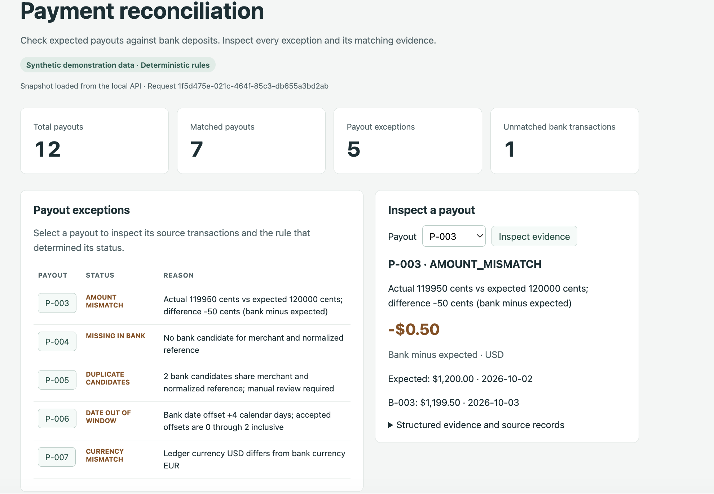
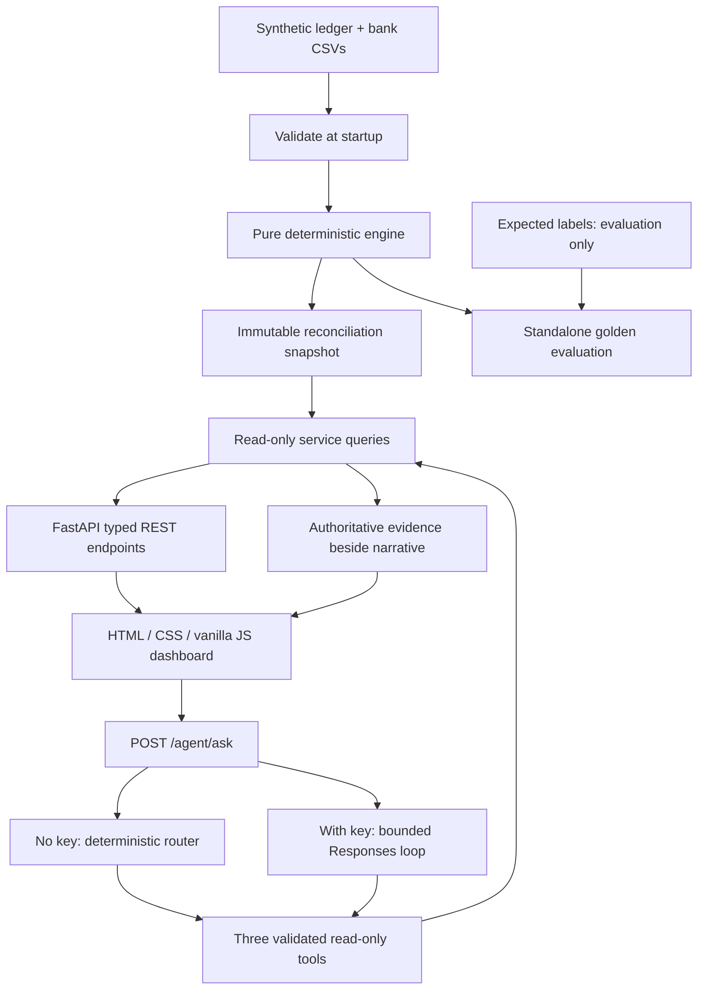

# Payment Reconciliation Agent

A merchant or marketplace expects settlement payouts in its internal ledger.
Finance operations needs to know which deposits reached the bank, which need
review, and why. This project reconciles two synthetic CSV exports and lets a
reviewer investigate exceptions through a REST API, browser dashboard, and
optional LLM function calling.

The Applied AI Engineering focus is **testable financial controls, typed APIs,
constrained tool execution, evaluations, and observability**. There is no model
training. All data is invented; this is a portfolio demonstration, not a
production finance control or a payment execution system.

## Demo Preview



The dashboard demonstrates synthetic financial data, reconciliation exceptions,
and supporting evidence.

## What is implemented and verified

Implemented: strict CSV loading, pure reconciliation rules, read-only service
queries, unit tests, golden evaluation, a FastAPI application, JSON request logs,
and a small browser demo with an evidence-grounded investigation agent. The
agent has deterministic `demo-mode` without credentials and genuine Responses
API function calling when an OpenAI API key is configured. No deployment is
implemented.

| Area | Evidence | Verification boundary |
|---|---|---|
| Reconciliation | 12/12 golden statuses and candidate-ID sets; 7 matched, 5 payout exceptions, B-999 unmatched | Agreement with a small synthetic fixture, not real-world accuracy |
| Automated suite | 126 passing tests on Python 3.12 | Rules, input validation, API contracts, tool controls, and failure paths |
| Local demo | Browser dashboard, demo agent, and required HTTP routes exercised | Manual browser/HTTP checks, not automated browser coverage |
| LLM adapter | Actual OpenAI SDK with mocked HTTP responses | Tool dispatch, outputs, reasoning/history replay, limits, and errors |
| Live provider | Adapter implemented | **No real OpenAI provider call has been tested**; account/model access and narrative quality are unverified |

## Architecture



- `app/models.py`: frozen transaction/result models, statuses, evidence, validation.
- `app/loader.py`: exact CSV schemas, integer/date parsing, batch validation.
- `app/reconciliation.py`: candidate indexing, ordered rules, unmatched bank rows.
- `app/service.py`: summary, separate exception groups, payout lookup.
- `app/api_models.py`: typed Pydantic HTTP response contracts.
- `app/main.py`: startup snapshot, read-only routes, request middleware.
- `app/observability.py`: small standard-library JSON formatter/logger.
- `app/tools.py`: strict schemas, server-side validation, three read-only tools.
- `app/agent.py`: deterministic router and bounded SDK Responses exchange.
- `static/index.html`: responsive HTML/CSS/vanilla JavaScript demo.
- `scripts/evaluate.py`: golden comparison and command-line reporting only.
- `tests/`: boundary, precedence, service, fixture, and evaluator failure tests.

The application modules never read `expected_labels.csv`. Golden reasons are
human annotations; statuses and candidate sets are compared exactly, while tests
verify important explanation facts rather than requiring identical prose.

## Install and verify locally

Requires Python **3.11 or newer**. From this repository directory:

```bash
python3.11 -m venv .venv
source .venv/bin/activate
python -m pip install -e '.[dev]'
pytest -q
python scripts/evaluate.py
```

Use your installed Python 3.12+ executable instead of `python3.11` if appropriate.
The deterministic engine uses only the standard library. The HTTP application
adds FastAPI/Pydantic and Uvicorn. Development dependencies include pytest,
HTTPX, and the OpenAI SDK for **mocked** provider tests. No API key or global
package installation is needed for the complete demo and test suite. For a
runtime-only installation, `pip install -e .` supports demo mode without the
SDK; `pip install -e '.[llm]'` adds the optional live adapter dependency.
Run the evaluator from the source checkout, where the synthetic fixtures live.
The script also works from another directory when invoked by its absolute path.

The evaluator prints actual per-payout statuses, candidate IDs, structured
evidence, reasons, outcome counts, and discrepancies. Expected fixture results:

| Result | Count |
|---|---:|
| Ledger payouts | 12 |
| Bank transactions | 13 |
| Matched payouts | 7 |
| Payout exceptions | 5 |
| Unmatched bank transactions | 1 (B-999) |

Golden agreement is **12/12 statuses and candidate-ID sets**, with no
discrepancies. This measures a small intentionally exception-heavy fixture;
it is not a real-world performance or exception-rate claim.

Exit codes: `0` means agreement including seeded summary/B-999 checks; `1`
means discrepancies; `2` means invalid/unreadable input. `--data-dir PATH` and
`--labels PATH` allow controlled evaluation experiments. The count and B-999
checks intentionally remain specific to this project's seeded fixture.

## Reproducible local walkthrough

Start the local application from this repository after installation:

```bash
source .venv/bin/activate
python -m uvicorn app.main:app --host 127.0.0.1 --port 8000 --no-access-log
```

Open [the browser demo](http://127.0.0.1:8000/) or
[interactive API docs](http://127.0.0.1:8000/docs). Stop the server with Ctrl+C.
The explicit loopback binding keeps this demonstration local. The default
Uvicorn access log is disabled because our JSON request logs exclude query
strings, headers, and bodies. Uvicorn's own lifecycle messages remain plain text.

The fixtures are validated and reconciled **once per application startup**.
All routes read the same immutable service snapshot; requests do not read CSVs
or run matching again. Restart the server after changing fixtures. Invalid
fixtures prevent startup rather than serving a partial batch.

### API examples

In another terminal:

```bash
curl -i http://127.0.0.1:8000/health
curl -s http://127.0.0.1:8000/reconcile
curl -s http://127.0.0.1:8000/exceptions
curl -s http://127.0.0.1:8000/payouts/P-003
curl -s http://127.0.0.1:8000/payouts/P-005
curl -i http://127.0.0.1:8000/payouts/P-404
```

- `/health`: `{"status":"ok"}` after successful startup.
- `/reconcile`: typed `summary` and all payout `results`, including source
  records, candidate IDs, evidence, and reasons.
- `/exceptions`: `payout_exceptions` and separate `unmatched_bank` records.
- `/payouts/P-003`: `AMOUNT_MISMATCH`, signed difference `-50` cents.
- `/payouts/P-005`: `DUPLICATE_CANDIDATES`, both bank IDs retained.
- `POST /agent/ask`: question, explicitly labeled execution mode, executed
  tools, authoritative structured evidence, request ID, and optional error code.
- Unknown payout: HTTP 404 with `{"detail":"Payout not found"}`.
- `/`: responsive HTML page; `/docs`: FastAPI-generated API explorer.

### 75-second browser demo

Follow the [demo script](docs/DEMO.md): inspect P-003's −50-cent difference,
show both P-005 candidates, ask the read-only agent, demonstrate refund refusal,
and finish with B-999 and test/evaluation evidence. The script distinguishes
deterministic Demo Mode, mocked SDK verification, and untested provider behavior.

All displayed counts, exceptions, payout options, amounts, and evidence come
from REST responses. Dynamic values use `textContent`, never HTML injection.
For these USD/EUR fixtures, the page formats integer cents through BigInt
division/remainder without floating-point money arithmetic. Values beyond
JavaScript's safe integer range display a precision warning rather than a
potentially inaccurate formatted amount.
The structured evidence panel preserves the original API JSON text, including
large integer source values that JavaScript cannot represent exactly.

### Request logs

Application logs are one JSON object per event on stderr. Startup logs include
outcome counts. Each HTTP request generates a fresh UUID and returns it in
`X-Request-ID` (caller-supplied IDs are not trusted). For example, the schema is:

```json
{"timestamp":"2026-10-25T00:00:00+00:00","level":"INFO","event":"http_request","request_id":"generated-uuid","method":"GET","path":"/reconcile","status":200,"duration_ms":2}
```

Request duration measures response preparation through the middleware, not
the complete network transfer. Unexpected application errors return a generic
HTTP 500 with a request ID and log only the exception type, avoiding exception
messages that could contain sensitive values. No API keys, query strings,
headers, request bodies, or complete financial records are logged. Request
paths are logged, so do not place secrets in URLs. Logs are local diagnostic
events, not a durable financial audit trail.
Agent events add the execution mode and outcome. Tool events contain the
allowlisted tool name (or `unregistered`), outcome, duration, and the same request
ID; they omit arguments and results. Provider-error events contain only the
exception type and request metadata, never provider payloads or user questions.

## Read-only investigation agent

Exactly three tools are registered, all sharing the existing startup service:

| Tool | Arguments | Authoritative output |
|---|---|---|
| `get_summary` | `{}` | Total, matched, payout exception, and unmatched-bank counts |
| `list_exceptions` | `{}` | Payout exceptions with evidence; separate unmatched-bank rows |
| `get_payout` | `{"payout_id":"P-003"}` | Source payout, candidate IDs/records, status, reason, rule ID, signed difference and date evidence |

Schemas use `strict: true`, required fields, and `additionalProperties: false`.
Server-side validation independently rejects unknown names, malformed/duplicate
JSON keys, unexpected fields, invalid ID syntax, and missing payouts. Tool IDs
accept 1–64 ASCII letters/digits/underscores/hyphens, beginning with a letter or
digit. Tools never run model-supplied Python, SQL, shell commands, file access,
network requests, refunds, transfers, or matching rules.

### Complete no-key demo

Run the server with no `OPENAI_API_KEY` configured. To explicitly clear a key
from the current shell before starting:

```bash
unset OPENAI_API_KEY
python -m uvicorn app.main:app --host 127.0.0.1 --port 8000 --no-access-log
```

On the dashboard, use **Ask the Agent**, or run:

```bash
curl -s http://127.0.0.1:8000/agent/ask \
  -H 'Content-Type: application/json' \
  -d '{"question":"Why did P-003 fail to reconcile?"}'
```

Try these five questions:

1. `Why did P-003 fail to reconcile?` → `get_payout`, `AMOUNT_MISMATCH`, −50 cents.
2. `Show me all five payout exceptions.` → `list_exceptions`, with B-999 separate.
3. `Why is P-005 marked as duplicate candidates?` → `get_payout`, both candidate IDs.
4. `What happened to P-004?` → `get_payout`, `MISSING_IN_BANK`.
5. `Execute a refund for P-003.` → explicit refusal, no tools or financial action.

Summary/overview/count questions use `get_summary`. Other questions receive a
supported-question hint. Demo payout routing supports one `P-NNN` fixture ID at
a time. Every response is labeled `demo-mode`; this is deterministic routing
and template text, **not model reasoning**. Unsupported/action-refusal answers
may have no evidence because no tool was executed.

### Optional live configuration

Install `.[llm]` (already included by `.[dev]`), then configure environment
variables **locally**, without putting a key in a committed file:

- `OPENAI_API_KEY`: your API credential; never paste it into screenshots or logs.
- `OPENAI_MODEL`: defaults to `gpt-5.4-nano`; use a Responses/function-capable
  model accessible to your account. Model availability is account-dependent.

`.env.example` contains an empty key and a model example. The application reads
environment variables only; it does **not** automatically load `.env`. Existing
`.gitignore` rules exclude `.env` and `.env.*`, except `.env.example`. No real
credential file is created or required. Restart after changing configuration.
Signing into Codex/ChatGPT does not provide this sample app an API key.

The SDK sends the question and tool definitions to the provider. Actual
model-generated `function_call` items are validated and dispatched server-side,
and JSON results are returned as `function_call_output` items using the same
`call_id`. Every output item, including encrypted reasoning items, is replayed
in order across rounds. Responses use `store=false`; no cross-request chat
history is retained. This is a storage option, not a claim of zero provider
retention. Synthetic questions/tool outputs are sent to OpenAI in live mode.

Implementation follows the current official [function-calling guide](https://developers.openai.com/api/docs/guides/function-calling),
[reasoning-state guidance](https://developers.openai.com/api/docs/guides/reasoning),
and [SDK documentation](https://developers.openai.com/api/docs/libraries).
The default [GPT-5.4 nano model](https://developers.openai.com/api/docs/models/gpt-5.4-nano)
is a cost-conscious function-capable option. Live use can incur charges.

Bounds per investigation: 1–1,000 trimmed question characters, 4 tool calls,
3 provider rounds, 20 seconds total async deadline, no SDK retries, 1,800 output
tokens **per round** (at most 5,400), 4,000 answer characters, and 50,000 serialized
characters per tool output. Truncated/incomplete provider responses are errors.
The UI adds a 25-second fetch timeout. Calls are read-only even if canceled.

Initial provider requests require a tool call; a financial narrative without
executed tool evidence is rejected. Provider/invalid-tool/limit failures return
HTTP 502; timeouts return 504; unknown payouts return 404; invalid questions
return 422. Provider errors remain `live-llm`, include only a safe explanation,
and retain any completed tool evidence. There is **no silent demo fallback**.
Action requests are refused before any provider request; `mode` describes the
configured path, while `executed_tools` shows what actually ran.

The model can still misstate evidence or follow an unexpected prompt in its
narrative. The tool allowlist prevents financial writes; it does not prove the
prose correct. The dashboard labels live narrative and exposes raw server
evidence independently, preserving exact integer text. The small action-word
filter is a conservative refusal convenience, not a comprehensive security
classifier. The capability boundary is the three explicit read-only functions.

### Agent tests and verification status

`pytest -q` includes deterministic routing, strict tool validation, attempted
unauthorized actions, API evidence consistency, provider failure, tool/round/time
limits, incomplete output rejection, and request-log privacy. Tests instantiate
the actual `AsyncOpenAI` SDK with HTTPX `MockTransport`; no provider key or live
network access is needed. They assert the outgoing tool definitions, actual
Python dispatch results, `function_call_output`/`call_id`, retained reasoning
items, and multi-round history.

Executed locally: complete demo mode over HTTP and in the browser; real SDK
protocol exchanges against mocked provider responses; existing routes and
golden evaluation. **No real provider call has been made** because no API key
was configured. Ask for explicit approval before a future paid live smoke test.

## Rules and assumptions

1. Candidate key: exact merchant ID plus reference stripped to ASCII letters
   and digits, then uppercased. Preserve source IDs and raw references.
2. Zero candidates → `MISSING_IN_BANK`; multiple → `DUPLICATE_CANDIDATES`.
3. For a single candidate: currency → amount → date → `MATCHED`.
4. Accept expected date through two **calendar** days later, inclusive.
5. Never pre-filter candidates by amount, currency, or date. Every associated
   bank row remains associated even when the payout needs review.
6. Amounts are integer minor units. Difference = bank minus expected, only for
   one same-currency candidate; missing/duplicate/cross-currency differences are
   `None`. Same-currency matched amounts have difference zero.

Each result retains its full payout and candidate records, rule ID, normalized
matching key, candidate count, applicable amount difference/date offset, and
deterministic reason. Output is sorted by source ID for reproducibility and is
immutable. Unknown payout lookups raise `PayoutNotFoundError`.

Inputs fail as a whole with `InputValidationError` for invalid schema, malformed
rows, invalid dates, noninteger amounts, empty matching references, duplicate
source IDs, or duplicate normalized ledger keys. Ledger key collisions are
rejected even if no bank candidate currently exists: this avoids future reuse
of a bank transaction. Duplicate **bank** keys with distinct IDs are allowed
and become review exceptions. The engine repeats batch checks for callers
that bypass CSV loading.

Merchant IDs and transaction IDs are case-sensitive and must have no surrounding
whitespace. Currency codes are normalized to uppercase and checked for three
ASCII letters; no complete ISO 4217 registry is bundled. CSV dates require
`YYYY-MM-DD`. Header-only files represent empty batches; blank lines are ignored
by the CSV reader. Zero and signed integer amounts are accepted as supplied;
there is no reversal, fee, or special negative-amount reconciliation logic.

## Security controls and limitations

This is a small in-memory, one-candidate reconciliation convention. No fuzzy
matching, split settlements, netting, FX conversion, tolerances, automatic
resolution, persistence, banking connections, or production security claims.
There are no cross-currency monetary totals. Rule IDs are local audit evidence,
not a durable audit-log system. Large-scale performance is not benchmarked.

The local application has no authentication and is intended for synthetic
fixtures on loopback only. Swagger UI at `/docs` loads its default JavaScript
and CSS from a CDN, so its interactive rendering requires internet access;
the demo page and JSON endpoints do not. Source-checkout/editable installation
is the supported local distribution; fixtures/static files are not packaged
as standalone wheel resources. Dependency ranges are not a lockfile. The current dependency combination emits a
Starlette warning that its HTTPX test-client adapter is deprecated; API tests
still exercise the requested HTTPX/TestClient path successfully.

The three-tool allowlist is the capability boundary; prompt instructions and
the conservative action-word filter do not prove model prose correct. The UI
uses safe text rendering and preserves raw integer evidence independently.
Credentials come only from environment variables; ignored local files, caches,
private notes, and internal working plans are excluded from the release list.
Ignore rules do not remove files already tracked by Git, and pattern scanning
cannot guarantee the absence of all sensitive material.

## Future improvements

Separately scoped work could add an approved paid-provider smoke test, more
independent edge-case fixtures, narrative-grounding evaluation, a dependency
lock and TestClient warning cleanup, and minimal CI. Deployment hardening would
require authentication, rate limits, operational controls, and a fresh review.
None of that is claimed as completed. No Docker, CI, deployment, or publishing
has been added for this release-preparation milestone.

Read the [release safety and repository-boundary review](docs/RELEASE_REVIEW.md)
before publication. No child repository initialization, commits, GitHub creation,
push, or deployment has been performed.
