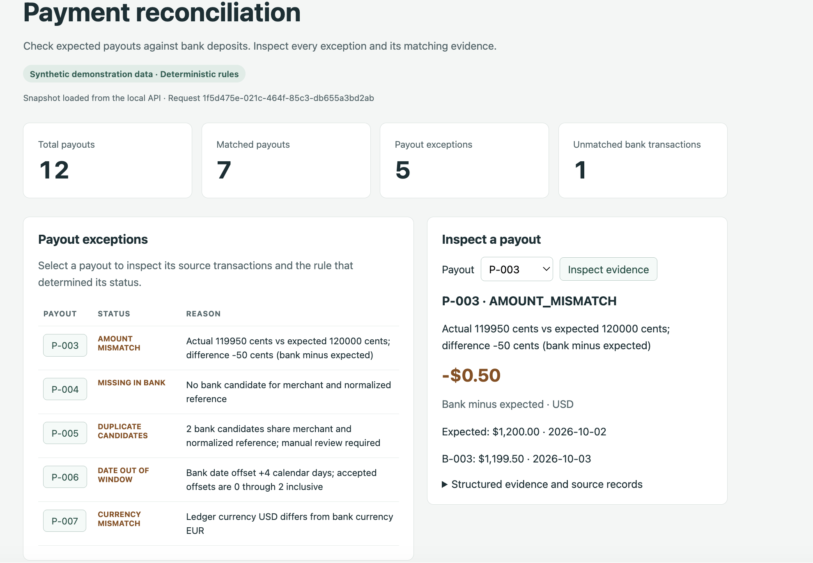
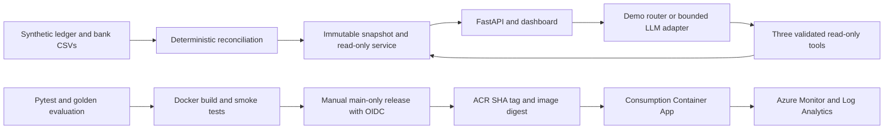

# Payment Reconciliation Agent

An Applied AI / Forward Deployed Engineering portfolio project: reconcile
synthetic merchant payouts against bank exports, investigate exceptions through
typed APIs and a dashboard, and ship a reproducible Azure demo with CI quality
gates, scoped identities, observable requests, and an ephemeral cloud lifecycle.

The deterministic engine owns reconciliation decisions. The optional agent has
three validated, read-only tools; demo mode requires no API key. No financial
actions, real customer data, model training, or RAG are involved.



## Engineering milestones and evidence

| Milestone | Completed work and verification |
|---|---|
| Reconciliation and application | FastAPI, dashboard, integer-cent rules, immutable evidence, constrained agent tools; **12/12 golden agreement** |
| Docker | Python 3.12 slim, non-root user, runtime dependencies and synthetic assets; no-key HTTP smoke checks |
| CI quality gates | GitHub-hosted pytest and golden evaluation gate Docker build and `/health`, `/docs`, `/exceptions` checks; failure gating demonstrated on [PR #1](https://github.com/yj-projects/payment-recon-agent/pull/1) |
| Azure deployment and OIDC | Consumption Container App, Basic ACR, managed-identity pulls, short-lived GitHub OIDC; tested image transferred without rebuilding, SHA-tagged and deployed by digest |
| Azure Monitor | Resource-specific console/system tables; API request ID correlated across application logs; inspected sensitive-payload markers absent |
| Release reliability | 45-minute job budget, bounded readiness polling, partial-release checkpoints, and separate recovery evidence; [incident review](docs/incidents/2026-11-21-first-release-timeout.md) |
| Microsoft Foundry | One keyless `gpt-5-mini-2025-08-07` request containing five synthetic questions; standalone inference and offline evaluation, with [sanitized results](experiments/foundry/results/2026-11-21-one-request.json) |

The final local suite has **491 passing tests**. The previously merged main
[CI run](https://github.com/yj-projects/payment-recon-agent/actions/runs/44963961561)
verified 481 tests before the ten mini-lab tests were added. See the latest
[GitHub Actions checks](https://github.com/yj-projects/payment-recon-agent/actions)
for hosted verification of the portfolio branch.

Foundry results: **5/5 decisions correct, 4/4 substantive factual cases correct,
zero unsupported structured facts, and one refusal check passed**. Azure reported
**556 tokens** (432 input, 124 output); client latency was **6.420 seconds**,
including authentication. Estimated token cost was **USD 0.000356**, excluding
tax. These are model-generated answers scored against local synthetic labels,
not production reconciliation evidence. One request does not establish general
accuracy. See the [mini-lab guide](experiments/foundry/README.md).

## Architecture



The Foundry mini-lab runs separately; it is not wired into this application or
CI. Production demo reconciliation remains deterministic and credential-free.

## Run locally

Use Python 3.12. These commands use synthetic fixtures and make no model calls.

```bash
python3.12 -m venv .venv
source .venv/bin/activate
python -m pip install -e '.[dev]'
pytest -q
python scripts/evaluate.py
unset OPENAI_API_KEY
python -m uvicorn app.main:app --host 127.0.0.1 --port 8000 --no-access-log
```

Open the dashboard at `http://127.0.0.1:8000/` and API docs at `/docs`.
Try “Why did P-003 fail to reconcile?” or “Execute a refund for P-003.” The
latter is refused without a financial action. The fixture has 12 payouts:
seven matched, five exceptions, and one separate unmatched bank transaction.

```bash
docker build -t payment-recon-demo .
docker run --rm -p 127.0.0.1:8000:8000 payment-recon-demo
# Offline preview: no authentication or model invocation.
python experiments/foundry/mini_lab.py
```

## Deployment controls and honest limitations

- PRs and pushes to main run CI. Docker depends on validation; release depends
  on both jobs, main, explicit manual confirmation, and the deployment flag.
  `AZURE_DEPLOYMENT_ENABLED=false` is the stopping state. Disabling deployment
  does not stop the already-public app or its charges.
- The [original Azure release run](https://github.com/yj-projects/payment-recon-agent/actions/runs/44955542503)
  **was cancelled at its 20-minute timeout**, despite Azure completing a working
  app deployment. Later operator verification is separate evidence; no successful
  workflow receipt is claimed.
- Improved CD passed automated tests but **has not been validated by another
  live cloud release**. **A real rollback exercise has not been performed.**
- Foundry was a **standalone mini-lab**, not an application integration. The
  application's live OpenAI tool-calling adapter remains tested with mocked SDK
  exchanges; the Foundry result does not validate that adapter.
- Demo agent evaluation preserves **AE-013**: 19/20 tool-selection agreement and
  a nonzero evaluator exit. It stays outside mandatory CI; failures are not hidden.
- Five Foundry cases are not a general hallucination benchmark. The refusal is
  explicitly requested, not an adversarial safety test. Latency/tokens are per
  combined request, not per question.
- The public synthetic demo has no authentication or rate limiting. Read-only
  tools prevent financial writes; they do not guarantee narrative correctness.
  Logs omit query strings, headers, and bodies, but paths must not contain secrets.
- Dependency ranges/base tags are not fully locked. The current suite emits a
  TestClient dependency deprecation warning. Golden agreement covers a small
  synthetic fixture, not real-world financial accuracy.

## Reproduce, inspect, and clean up

- [Azure lifecycle guide](docs/AZURE_DEPLOYMENT.md): setup prerequisites, scoped
  roles, OIDC, digest releases, log inspection, rollback procedure, and costs.
- [Final inventory and teardown checklist](docs/PROJECT_CLOSURE.md): cleanup
  boundary, exact confirmation-gated commands, and post-deletion checks.
- [Foundry experiment](experiments/foundry/README.md): fixtures, source, tests,
  one-call evidence, pricing, setup commands, and limitations.
- [Agent evaluation](docs/AGENT_EVALUATION.md): baseline cases, scoring, and AE-013.
- [75-second demo](docs/DEMO.md) and [release boundary review](docs/RELEASE_REVIEW.md).

Cloud resources are temporary; source and sanitized evidence remain in GitHub.
ACR and usage/logging charges continue until approved cleanup. The USD 30 budget
is an alert, not a spending cap. **Nothing is deleted automatically.**
